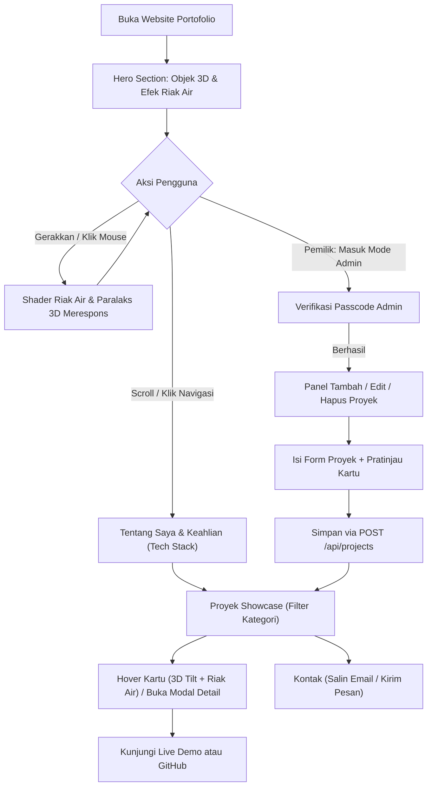

# Product Requirements Document (PRD)
## Website Portofolio Pribadi Interaktif — `About_me`

| Metadata | Detail |
| :--- | :--- |
| **Nama Proyek** | `About_me` — Personal Interactive 3D Portfolio |
| **Versi Dokumen** | `1.0.0` |
| **Tanggal** | 24 November 2026 |
| **Pemilik Produk** | `[Nama Lengkap Anda]` — Mahasiswa IT & Web Developer |
| **Institusi / Mata Kuliah** | `[Nama Universitas / Jurusan]` — Tugas Pemrograman Web |
| **Status** | Draft Siap Implementasi |
| **Tech Stack Dasar** | Next.js `16.4.6` (App Router + Turbopack), React `19.3.0`, Tailwind CSS `4.3.3`, TypeScript `5` |

---

## 1. Ringkasan Eksekutif & Visi Produk

### 1.1 Latar Belakang
Sebagai mahasiswa IT dan calon *Web Developer*, memiliki website portofolio pribadi bukan sekadar memenuhi tugas mata kuliah pemrograman web, melainkan aset utama untuk menunjukkan kemampuan teknis secara nyata kepada dosen penilai, HRD, dan *tech recruiter* saat melamar magang maupun pekerjaan.

Portofolio statis konvensional sering kali kurang menonjol dan mengharuskan pemilik mengedit kode sumber setiap kali ingin menambahkan proyek baru. Oleh karena itu, `About_me` dirancang sebagai website portofolio pribadi yang **kreatif, imersif, dan interaktif** — menggabungkan **elemen 3D WebGL**, **efek interaksi kursor menyerupai riak permukaan air (*water ripple / fluid distortion*)**, serta **kemampuan menambah dan mengelola proyek langsung dari antarmuka web**.

### 1.2 Visi Produk
> Menghadirkan website portofolio pribadi yang memadukan estetika *creative coding* (3D + interaksi air berbasis kursor) dengan rekayasa perangkat lunak modern (Next.js Full-Stack), sehingga meninggalkan kesan visual yang kuat sekaligus mudah dikelola secara mandiri.

### 1.3 Proposisi Nilai (*Value Proposition*)
1. **Imersif & Berkesan**: Unsur 3D interaktif dan efek riak air saat mouse bergerak menjadikan pengalaman menjelajah halaman terasa hidup dan langsung membuktikan kemampuan *frontend* & *creative engineering*.
2. **Mandiri & Dinamis**: Pemilik dapat menambah, mengedit, atau menghapus proyek langsung melalui web tanpa perlu mengubah kode dan *re-deploy* secara manual.
3. **Siap Akademis & Industri**: Dibangun dengan arsitektur Next.js App Router, TypeScript ketat, validasi data, responsif di semua perangkat, dan memperhatikan aksesibilitas serta performa.

### 1.4 Metrik Keberhasilan (*Success Metrics / KPIs*)

| Kategori | Metrik | Target |
| :--- | :--- | :--- |
| **Penilaian Akademis** | Kelengkapan 5 bagian inti + unsur 3D + efek riak air + fitur tambah proyek dari web | 100% fitur MVP berjalan stabil tanpa *runtime error* |
| **Kejelasan Profil (Rekrutmen)** | Waktu bagi *recruiter* untuk memahami nama, peran, *tech stack*, dan akses proyek | < 10 detik sejak halaman terbuka (*above the fold*) |
| **Performa & Kualitas Web** | Skor Google Lighthouse (Desktop) | Performance ≥ 85–90, Accessibility ≥ 95, Best Practices ≥ 95, SEO ≥ 95 |
| **Kelancaran Animasi / WebGL** | *Frame rate* saat menggerakkan mouse pada efek riak air & objek 3D (Desktop) | Stabil di 60 FPS (tanpa *jank* atau *layout shift*, CLS < 0.1) |
| **Kemudahan Pengelolaan** | Waktu yang dibutuhkan pemilik untuk menambahkan 1 proyek baru dari UI web | < 2 menit dan langsung tampil di daftar proyek setelah *refresh* |

---

## 2. Target Audiens & User Persona

### Persona 1: Dosen / Penilai Tugas Mata Kuliah Web
- **Profil**: Pengajar mata kuliah pengembangan web.
- **Kebutuhan**: Menilai penerapan konsep web modern (komponen modular, routing, state management, API/CRUD, responsivitas, estetika UI/UX, dan kualitas kode TypeScript).
- **Ekspektasi**: Aplikasi bebas *bug*, kode bersih dan terstruktur, responsif di *mobile* maupun *desktop*, serta memiliki nilai kreativitas tinggi.

### Persona 2: HRD & Tech Recruiter (Magang / Junior Developer)
- **Profil**: Perekrut atau *engineering manager* yang meninjau puluhan portofolio kandidat setiap hari.
- **Kebutuhan**: Melihat ringkasan profil, keahlian teknis, dan bukti proyek nyata (demo langsung + tautan GitHub) dengan cepat.
- **Ekspektasi**: Navigasi tidak membingungkan meskipun banyak animasi, informasi mudah dibaca, dan tautan kontak/GitHub/LinkedIn langsung tersedia.

### Persona 3: Pemilik Portofolio / Admin (Anda Sendiri)
- **Profil**: Mahasiswa IT yang terus menghasilkan proyek tugas kuliah, hackathon, maupun proyek pribadi.
- **Kebutuhan**: Memperbarui daftar portofolio proyek secara cepat langsung dari browser tanpa membuka editor kode.
- **Ekspektasi**: Formulir tambah proyek yang praktis, ada pratinjau instan, data tersimpan permanen, dan aman dari pengubahan oleh pengunjung umum.

---

## 3. Ruang Lingkup Produk (*Scope*)

### 3.1 In-Scope (MVP — Versi 1.0)
- **5 Bagian Utama**:
  1. **Hero Section**: Perkenalan diri, objek 3D interaktif, dan latar/visual dengan efek riak air responsif terhadap kursor.
  2. **Tentang Saya (*About Me*)**: Profil singkat mahasiswa IT, foto/avatar interaktif, dan kartu sorotan (*highlights*).
  3. **Keahlian (*Tech Stack*)**: Pengelompokan teknologi yang dikuasai dengan interaksi mikro halus.
  4. **Proyek (*Projects Showcase*)**: Galeri proyek dengan filter kategori, efek *3D hover tilt* + riak air pada thumbnail, modal detail proyek, serta tombol Demo & GitHub.
  5. **Kontak (*Contact Section*)**: Tautan sosial media, tombol salin email cepat, dan formulir pesan dengan validasi.
- **Fitur Interaktif Utama**:
  - Elemen **3D WebGL** interaktif (bereaksi terhadap posisi kursor dan rotasi halus).
  - Efek **riak/gelombang air (*water ripple / fluid distortion*)** berbasis *shader* ketika mouse bergerak atau diklik di atas kanvas/gambar.
  - Animasi halus di seluruh halaman (*scroll reveal*, *staggered text*, transisi modal) dengan dukungan `prefers-reduced-motion`.
- **Manajemen Proyek Langsung dari Web**:
  - Mode Admin terproteksi (login *passcode* sederhana).
  - Fitur **Tambah Proyek Baru**, **Edit Proyek**, dan **Hapus Proyek** langsung dari web.
  - Persistensi data melalui Next.js Route Handlers (`app/api/projects`).

### 3.2 Out-of-Scope (Fase Berikutnya — Versi 2.0)
- Sistem blog/artikel dengan *rich-text CMS*.
- Pendaftaran multi-pengguna (*multi-tenant*).
- Dukungan multi-bahasa penuh (Indonesia/Inggris *toggle*).
- Analitik pengunjung kustom (*built-in dashboard analytics*).

---

## 4. Arsitektur Informasi & Alur Pengguna (*User Flow*)

### 4.1 Struktur Navigasi
- **Header (*Sticky Glassmorphism Navbar*)**:
  - Logo / Nama (`[Nama / Inisial]`) → kembali ke atas (`#hero`).
  - Menu utama: `Beranda`, `Tentang`, `Keahlian`, `Proyek`, `Kontak`.
  - Akses Admin: Ikon/tombol diskret (atau rute `/admin` / pintasan keyboard seperti `Ctrl+Shift+A`) untuk membuka panel pengelolaan proyek.
- **Footer**:
  - Hak cipta, tautan cepat bagian halaman, dan ikon media sosial (GitHub, LinkedIn, Email, Instagram).

### 4.2 Diagram Alur Pengguna (Pengunjung & Admin)



---

## 5. Spesifikasi Fungsional (*Functional Requirements*)

### FR-01: Navigasi & Header Interaktif
- **User Story**: *Sebagai pengunjung, saya ingin berpindah antar bagian dengan mulus dan mengetahui posisi saya saat ini di halaman.*
- **Kebutuhan**:
  - Navbar menempel di atas (*sticky*) dengan efek transparan buram (*backdrop-blur*) saat halaman di-*scroll*.
  - *Scroll spy* otomatis menyorot menu bagian yang sedang aktif.
  - Pada layar *mobile* (`< 768px`), menu berubah menjadi tombol *hamburger* dengan *drawer* beranimasi halus.
  - Perpindahan antar bagian menggunakan *smooth scrolling*.

### FR-02: Hero Section (3D + Efek Riak Air)
- **User Story**: *Sebagai recruiter atau dosen, saya ingin langsung mengenali identitas pemilik portofolio sekaligus terkesan dengan kemampuan visual interaktifnya.*
- **Kebutuhan**:
  - Menampilkan sapaan singkat, nama lengkap (`[Nama Lengkap Anda]`), peran/headline (`Mahasiswa IT & Web Developer`), serta 1–2 kalimat *value proposition*.
  - Menampilkan **kanvas 3D interaktif** (objek 3D bergaya *liquid metal / frosted glass / geometric abstract* yang merespons pergerakan kursor secara halus).
  - Latar belakang atau lapisan visual hero memiliki **efek riak air (*water ripple*)** saat mouse digerakkan melintasinya.
  - Dua tombol CTA utama: **"Lihat Proyek"** (menggulir ke `#projects`) dan **"Hubungi Saya"** (menggulir ke `#contact`).
  - Indikator *scroll down* halus di bagian bawah hero.

### FR-03: Tentang Saya (*About Me*)
- **User Story**: *Sebagai pengunjung, saya ingin mengenal latar belakang pendidikan, minat teknologi, dan kesiapan kolaborasi/magang pemilik portofolio.*
- **Kebutuhan**:
  - Foto profil/avatar dalam bingkai interaktif (bereaksi dengan efek *water ripple* halus atau *3D tilt* saat kursor menyentuhnya).
  - Narasi singkat mengenai perjalanan belajar sebagai mahasiswa IT (`[Semester / Jurusan / Universitas]`).
  - Kartu sorotan (*Bento Highlight Cards*), misalnya: Fokus Bidang (Full-Stack / Frontend / Creative Web), Pendidikan Saat Ini, dan Status Ketersediaan (`Terbuka untuk Magang & Kolaborasi`).

### FR-04: Keahlian (*Tech Stack*)
- **User Story**: *Sebagai recruiter, saya ingin melihat daftar teknologi yang dikuasai secara terkelompok agar mudah mencocokkan dengan kebutuhan posisi magang/kerja.*
- **Kebutuhan**:
  - Keahlian dikelompokkan berdasarkan kategori:
    - **Frontend**: Next.js, React, TypeScript, Tailwind CSS, HTML/CSS.
    - **3D & Animasi**: Three.js, React Three Fiber, GLSL Shaders, Motion.
    - **Backend & Database**: Node.js, REST API, SQLite / PostgreSQL, Prisma.
    - **Tools & Workflow**: Git, GitHub, Figma, Vercel, VS Code.
  - Setiap item menampilkan ikon, nama teknologi, dan animasi *micro-interaction* saat *hover*.

### FR-05: Proyek (*Projects Showcase*)
- **User Story**: *Sebagai pengunjung, saya ingin memfilter proyek berdasarkan kategori, melihat detailnya, serta mengakses demo langsung dan kode sumbernya.*
- **Kebutuhan**:
  - Filter kategori proyek (mis. `Semua`, `Web App`, `3D / Interaktif`, `Tugas Kuliah`, `UI/UX`).
  - Setiap kartu proyek menampilkan: gambar *thumbnail* (dilengkapi efek riak air halus / *3D hover tilt*), judul, ringkasan singkat (maks. 2 baris), *badge* teknologi, serta tautan **Live Demo** dan **GitHub**.
  - Klik pada kartu membuka **Modal / Drawer Detail Proyek** berisi deskripsi lengkap, peran, tantangan & solusi, daftar teknologi, dan tombol tautan.
  - *Empty state* informatif apabila filter tidak menemukan proyek yang cocok.

### FR-06: Tambah & Kelola Proyek Langsung dari Web (*In-Web Project Manager*)
- **User Story**: *Sebagai pemilik portofolio, saya ingin menambahkan, mengubah, atau menghapus proyek langsung dari website tanpa harus membuka kode sumber.*
- **Kebutuhan**:
  - **Akses Terproteksi**: Hanya dapat digunakan setelah pemilik memasukkan *passcode* admin (disimpan di environment variable `ADMIN_PASSCODE`, diverifikasi via server dengan *HTTP-only cookie*).
  - **Tombol "+ Tambah Proyek"**: Muncul otomatis di bagian Proyek (atau di halaman `/admin`) ketika pemilik sedang dalam status terautentikasi.
  - **Formulir Tambah / Edit Proyek**:
    - Judul Proyek *(wajib, maks. 80 karakter)*
    - Kategori *(wajib: pilihan dropdown)*
    - Ringkasan Singkat *(wajib, maks. 160 karakter)*
    - Deskripsi Lengkap *(opsional / wajib untuk detail)*
    - Tech Stack *(input multi-tag, mis. `Next.js, Tailwind, Three.js`)*
    - Thumbnail Proyek *(mendukung input URL gambar atau unggah file gambar lokal/storage maks. 2 MB format JPG/PNG/WebP)*
    - URL Live Demo *(opsional, validasi format URL)*
    - URL Repository GitHub *(opsional, validasi format URL)*
    - Opsi *Featured / Unggulan* *(checkbox)*
  - **Pratinjau Langsung (*Live Card Preview*)**: Menampilkan tampilan kartu proyek secara *real-time* saat pemilik mengisi formulir.
  - **Umpan Balik & Persistensi**: Menampilkan notifikasi *toast* saat berhasil/gagal; setelah disimpan, proyek baru langsung muncul di daftar proyek tanpa *reload* manual dan tetap ada setelah halaman di-*refresh*.
  - **Aksi Edit & Hapus**: Dilengkapi dialog konfirmasi sebelum menghapus proyek.

### FR-07: Kontak (*Contact Section*)
- **User Story**: *Sebagai recruiter atau kolaborator, saya ingin menghubungi pemilik portofolio dengan mudah melalui email, media sosial, atau formulir pesan.*
- **Kebutuhan**:
  - Kartu info kontak cepat: tombol **Salin Email** (*one-click copy to clipboard* + notifikasi *toast* "Email disalin!"), tautan GitHub, LinkedIn, dan media sosial lainnya.
  - Formulir kontak: Nama, Email, Subjek, dan Pesan dengan validasi sisi klien (`zod`), indikator *loading*, serta pesan sukses/gagal yang jelas.

---

## 6. Spesifikasi Interaksi 3D, Efek Riak Air (*Water Ripple*) & Animasi

### 6.1 Efek Riak Air Berbasis Gerakan Mouse (*Water Ripple / Fluid Distortion*)
- **Pengalaman yang Diinginkan**:
  - Saat kursor digerakkan melintasi area latar Hero atau permukaan gambar proyek/foto profil, muncul gelombang riak (*displacement ripple*) yang mengikuti lintasan kursor, menyebar melingkar, lalu mereda secara alami (*exponential damping*) — menyerupai permukaan air ketika disentuh jari/tangan.
  - Saat pengguna melakukan klik (*pointer down*), dihasilkan impuls riak yang sedikit lebih kuat.
- **Pendekatan Teknis**:
  - Menggunakan **WebGL / Three.js Custom GLSL Shader** (*2D wave equation ping-pong framebuffer* atau *multi-ripple displacement uniform array* untuk efisiensi tinggi).
  - *Fragment shader* menggeser koordinat UV tekstur gambar/latar berdasarkan gradien ketinggian gelombang (*normal perturbation*) ditambah sedikit efek kilau spekular (*caustic/refraction highlight*) agar terasa seperti air.
  - **Batasan UX**: Distorsi hanya diterapkan pada elemen visual (latar belakang kanvas & gambar), **tidak** mendistorsi teks isi utama agar keterbacaan (*readability*) tetap terjaga 100%.

### 6.2 Unsur 3D Interaktif
- **Lokasi Utama**:
  1. **Hero 3D Scene**: Objek 3D interaktif menggunakan **Three.js** + **React Three Fiber (`@react-three/fiber`)** + **`@react-three/drei`** — misalnya *iridescent liquid sphere / glass torus knot* atau model `.glb` bertema teknologi/developer yang melayang (*floating*) dan berotasi halus mengikuti koordinat kursor (*smooth lerp parallax*).
  2. **3D Micro-Interactions pada UI**: Kartu proyek dan *highlight card* memiliki efek *3D perspective tilt* halus saat *hover* serta pencahayaan *glare/spotlight* mengikuti posisi mouse.

### 6.3 Standar Animasi Halus & Aksesibilitas
- **Pustaka Animasi UI**: `motion` (Framer Motion) untuk *entrance stagger*, *scroll-triggered reveal* (`whileInView`), transisi filter proyek (*layout animation*), dan animasi modal.
- **Kepatuhan Performa**: Hanya menganimasikan properti ramah GPU (`transform`, `opacity`, WebGL uniforms) — hindari animasi pada `width`, `height`, `top`, `left`.
- **Aksesibilitas (`prefers-reduced-motion`)**:
  - Jika sistem operasi pengguna mengaktifkan *Reduce Motion*, efek riak air otomatis dinonaktifkan (menampilkan gambar/latar statis bersih), rotasi otomatis 3D dihentikan, dan transisi UI disederhanakan menjadi *fade* singkat.
- **Fallback Perangkat**:
  - Pada perangkat tanpa WebGL atau layar *mobile* berdaya rendah, kanvas 3D diganti secara otomatis (*graceful fallback*) dengan ilustrasi/gradient CSS modern ringan, dan interaksi sentuh (*touch*) hanya memicu riak ringan tanpa menurunkan FPS.

---

## 7. Arsitektur Teknis, API & Struktur Data

### 7.1 Tech Stack
- **Terpasang saat ini**:
  - `next`: `16.4.6` (App Router + Turbopack)
  - `react` & `react-dom`: `19.3.0`
  - `tailwindcss`: `4.3.3` + `@tailwindcss/turbopack`
  - `typescript`: `5`
  - `eslint` + `eslint-config-next`
- **Pustaka Tambahan yang Direkomendasikan saat Implementasi**:
  - `three`, `@types/three`, `@react-three/fiber`, `@react-three/drei` (3D & WebGL *water ripple shader*)
  - `motion` (animasi UI & *scroll reveal*)
  - `lucide-react` (ikon vektor konsisten)
  - `zod` (validasi skema formulir & payload API)

### 7.2 Rancangan Struktur Direktori

```text
About_me/
├── app/
│   ├── layout.tsx               # Root layout, metadata SEO, next/font
│   ├── globals.css              # Tailwind CSS v4 theme & custom utilities
│   ├── page.tsx                 # Halaman utama portofolio (Hero → Contact)
│   ├── admin/
│   │   └── page.tsx             # (Opsional) Halaman khusus kelola proyek
│   └── api/
│       ├── admin/
│       │   └── auth/route.ts    # Login & logout passcode admin
│       ├── projects/
│       │   ├── route.ts         # GET daftar proyek, POST tambah proyek
│       │   └── [id]/route.ts    # PATCH edit proyek, DELETE hapus proyek
│       └── contact/
│           └── route.ts         # POST pesan dari formulir kontak
├── components/
│   ├── canvas/
│   │   ├── Hero3DScene.tsx      # Scene 3D React Three Fiber (dynamic import)
│   │   └── WaterRippleCanvas.tsx# WebGL GLSL shader efek riak air
│   ├── sections/
│   │   ├── Navbar.tsx
│   │   ├── HeroSection.tsx
│   │   ├── AboutSection.tsx
│   │   ├── SkillsSection.tsx
│   │   ├── ProjectsSection.tsx
│   │   └── ContactSection.tsx
│   └── projects/
│       ├── ProjectCard.tsx      # Kartu proyek 3D tilt + ripple thumbnail
│       ├── ProjectModal.tsx     # Modal detail proyek
│       └── ProjectFormModal.tsx # Form tambah/edit proyek + live preview
├── data/
│   ├── profile.ts               # Data profil pribadi & tautan sosial
│   ├── skills.ts                # Data kategori keahlian
│   └── projects.json            # Penyimpanan awal / seed data proyek
├── lib/
│   ├── auth.ts                  # Helper verifikasi session/passcode admin
│   ├── projects-store.ts        # Layer abstraksi penyimpanan proyek
│   └── validators.ts            # Skema validasi Zod
└── docs/
    └── PRD.md                   # Dokumen PRD ini
```

### 7.3 Kontrak API (*Route Handlers*)

| Method | Endpoint | Akses | Deskripsi |
| :--- | :--- | :--- | :--- |
| `GET` | `/api/projects` | Publik | Mengambil seluruh daftar proyek (mendukung query `?category=`) |
| `POST` | `/api/projects` | Admin | Menambahkan proyek baru ke penyimpanan |
| `PATCH` | `/api/projects/[id]` | Admin | Memperbarui data proyek berdasarkan `id` |
| `DELETE` | `/api/projects/[id]` | Admin | Menghapus proyek berdasarkan `id` |
| `POST` | `/api/admin/auth` | Publik | Memverifikasi `passcode` dan mengatur *HTTP-only cookie* sesi admin |
| `DELETE` | `/api/admin/auth` | Admin | Menghapus sesi admin (*logout*) |
| `POST` | `/api/contact` | Publik | Memvalidasi & meneruskan/menyimpan pesan kontak |

### 7.4 Skema Data (*TypeScript Interfaces*)

```ts
export type ProjectCategory =
  | "Web App"
  | "3D / Interaktif"
  | "Tugas Kuliah"
  | "UI/UX";

export interface Project {
  id: string;
  title: string;
  summary: string;
  description: string;
  category: ProjectCategory;
  techStack: string[];
  thumbnailUrl: string;
  liveUrl?: string;
  githubUrl?: string;
  featured: boolean;
  createdAt: string; // ISO 8601
  updatedAt: string; // ISO 8601
}

export interface ProjectInput {
  title: string;
  summary: string;
  description: string;
  category: ProjectCategory;
  techStack: string[];
  thumbnailUrl: string;
  liveUrl?: string;
  githubUrl?: string;
  featured?: boolean;
}

export interface SkillCategory {
  id: string;
  name: string;
  items: {
    name: string;
    level: "Dasar" | "Menengah" | "Mahir";
    icon?: string;
  }[];
}
```

### 7.5 Strategi Persistensi Data Proyek
- **Tahap Pengembangan Lokal / Demo Tugas Kuliah**: File JSON terstruktur (`data/projects.json`) atau **SQLite + Prisma** yang dibaca/ditulis melalui `lib/projects-store.ts`.
- **Tahap Deployment Produksi (mis. Vercel)**: Karena *filesystem* serverless bersifat *read-only*, layer `lib/projects-store.ts` dirancang modular agar mudah dihubungkan ke database *cloud* gratis (**Supabase PostgreSQL** / **Neon** / **Turso SQLite**) serta **Vercel Blob / Cloudinary** untuk unggah gambar thumbnail.

---

## 8. Kebutuhan Non-Fungsional (*Non-Functional Requirements*)

1. **Performa**:
   - Komponen WebGL (`Hero3DScene`, `WaterRippleCanvas`) dimuat secara *lazy* (`next/dynamic` dengan `ssr: false`) agar HTML awal dan teks Hero langsung tampil cepat (LCP < 2.5 detik).
   - Resolusi kanvas WebGL dibatasi (`dpr={[1, 1.5]}` atau maksimal `2`) dan loop animasi dihentikan otomatis saat tab browser tidak aktif (*Page Visibility API*).
   - Semua gambar menggunakan optimasi `next/image` atau format WebP terkompresi.
2. **Keamanan**:
   - Semua input pada `POST/PATCH /api/projects` dan `POST /api/contact` divalidasi di sisi server menggunakan `zod`.
   - URL eksternal (`liveUrl`, `githubUrl`, `thumbnailUrl`) hanya mengizinkan protokol aman (`http://`, `https://`, atau path lokal `/uploads/...`) untuk mencegah XSS (`javascript:` URI).
   - *Passcode* admin disimpan di `.env.local` (tidak pernah di-*hardcode* di kode klien).
3. **Responsivitas & Kompatibilitas**:
   - Mendukung penuh breakpoint: Mobile (`360px–767px`), Tablet (`768px–1279px`), Desktop (`≥ 1280px`).
   - Diuji pada peramban modern terbaru: Chrome, Edge, Firefox, dan Safari.
4. **SEO & Aksesibilitas**:
   - Konfigurasi `metadata` lengkap di `app/layout.tsx` (judul, deskripsi, Open Graph).
   - Kontras teks terhadap latar minimal **4.5:1** (WCAG 2.1 AA), navigasi *keyboard* (`Tab`, `Escape` untuk menutup modal), serta atribut `aria-label` pada tombol ikon.

---

## 9. Kriteria Penerimaan (*Acceptance Criteria*)

- [ ] **Hero & 3D**: Objek 3D tampil mulus di Hero dan bereaksi saat kursor digerakkan tanpa menghalangi teks utama.
- [ ] **Efek Riak Air**: Menggerakkan atau mengklik mouse di area kanvas/gambar memunculkan gelombang riak menyerupai permukaan air dan mereda secara halus.
- [ ] **Navigasi & 5 Bagian Inti**: Hero, Tentang Saya, Keahlian, Proyek, dan Kontak seluruhnya lengkap, responsif di *mobile* dan *desktop*, serta memiliki animasi *scroll reveal* yang halus.
- [ ] **Tambah Proyek dari Web**: Pemilik dapat login dengan *passcode*, mengisi formulir proyek baru, melihat pratinjau kartu, menyimpannya, dan proyek tersebut langsung tampil di *Projects Showcase* serta tetap bertahan setelah halaman di-*refresh*.
- [ ] **Keamanan Admin**: Pengunjung biasa tanpa sesi admin tidak dapat memanggil `POST/PATCH/DELETE /api/projects` (mendapat respons `401 Unauthorized`).
- [ ] **Aksesibilitas & Fallback**: Mengaktifkan `prefers-reduced-motion` menonaktifkan animasi berat/distorsi riak air secara otomatis tanpa merusak tampilan.
- [ ] **Build Bersih**: `npm.cmd run build` dan `npm.cmd run lint` lulus tanpa error.

---

## 10. Roadmap & Tahapan Implementasi

| Fase | Fokus Pekerjaan | Keluaran Utama |
| :--- | :--- | :--- |
| **Fase 1: Fondasi & Design System** | Setup palet warna, tipografi (`next/font`), struktur data `profile.ts` & `skills.ts`, serta `Navbar` & `Footer`. | Kerangka halaman responsif dengan tema visual konsisten. |
| **Fase 2: Hero 3D & Efek Riak Air** | Implementasi `Hero3DScene` (React Three Fiber) dan `WaterRippleCanvas` (GLSL *water ripple shader*) + dukungan `prefers-reduced-motion`. | Hero imersif 60fps dengan 3D & interaksi air berbasis kursor. |
| **Fase 3: Bagian Inti Portofolio** | Implementasi `AboutSection`, `SkillsSection`, `ProjectsSection` (filter + modal detail + kartu 3D tilt), dan `ContactSection`. | Seluruh 5 bagian portofolio berfungsi penuh. |
| **Fase 4: Tambah Proyek dari Web** | Pembuatan API `/api/projects`, `/api/admin/auth`, validasi `zod`, persistensi data, dan `ProjectFormModal` dengan *live preview*. | Fitur CRUD proyek langsung dari antarmuka web yang aman. |
| **Fase 5: Optimasi & Deployment** | Audit Lighthouse, uji responsivitas *mobile/desktop*, penggantian *placeholder* dengan data asli Anda, dan *deploy* ke Vercel. | Website siap dikumpulkan untuk tugas kuliah & dibagikan ke *recruiter*. |

---

## Lampiran: Daftar Data Pribadi yang Perlu Diisi Sebelum Implementasi
Silakan siapkan informasi berikut agar dapat langsung dimasukkan ke `data/profile.ts`:
1. **Nama Lengkap & Nama Panggilan**
2. **Universitas, Jurusan, & Semester Saat Ini**
3. **Bio Singkat (2–3 kalimat) & Foto Profil**
4. **Daftar 2–4 Proyek Awal** (judul, deskripsi, teknologi, screenshot, link GitHub/Demo)
5. **Tautan Kontak**: Email, GitHub, LinkedIn, Instagram/Portfolio lainnya
